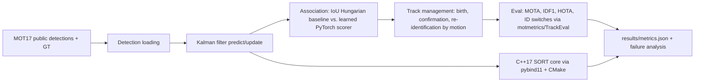

# Multi-object tracking on MOT17

Tracking-by-detection on the MOT17 training sequences, using the public detections rather than images. A constant-velocity Kalman filter plus Hungarian assignment is the SORT baseline. A small PyTorch network then scores track-detection pairs from motion and box geometry, and a C++17 port of the SORT core is checked against the Python tracks and timed per frame. Held-out numbers below are two MOT17 training sequences that were not used for training or for choosing the match threshold. They are not MOT17 test-server scores.

## Setup

```text
python -m venv .venv
.venv\Scripts\pip install -r requirements.txt
```

PyTorch is pinned to the CPU wheel. The first line of `requirements.txt` points pip at `https://download.pytorch.org/whl/cpu`.

## How to run

```text
python run.py
python run.py --quick
python run.py --device cpu --out results
```

`python run.py` downloads the MOT17 label archive if needed (cached under `data/`), builds the C++ extension with scikit-build-core and MSVC, trains the association model, selects the match threshold on the validation sequence, evaluates the two held-out sequences, and writes `results/`. `--quick` runs that same pipeline on a short prefix of the sequences and is meant to finish in a few minutes.

## Architecture



## Design decisions

The seven MOT17 scenes are split by name, in scene order, before any score is computed: train `MOT17-02/04/05/09-FRCNN`, validation `MOT17-10-FRCNN`, held out `MOT17-11/13-FRCNN`. Only the FRCNN public detections are used. DPM and SDP are the same videos, so putting another detector's copy of a held-out scene into training would leak that scene.

SORT uses the usual constant-velocity state `[cx, cy, area, aspect, velocities]`, an IoU gate of 0.3, `max_age=1`, and `min_hits=3`. The initializing detection does not count as a hit. Process noise follows the public SORT filter, including the double scaling of the aspect-velocity variance.

The learned tracker keeps the same filter. It can re-identify a track for 30 frames. A pair is eligible only if the predicted box overlaps the detection (IoU at least 0.15) or the last observation is still close. The network sees ten features: predicted IoU, last-observation IoU, both center distances divided by height, log height and width ratios, aspect difference, normalized time gap, velocity error, and detection confidence. Cost is `(1 - probability) + 0.15 * min(normalized distance)` for eligible pairs above a probability threshold. That 0.15 tie-break is fixed. The probability threshold is the only value chosen on the validation sequence, and it is chosen only among thresholds that do not raise identity switches by more than the allowed margin or lower MOTA there. Held-out sequences are scored once after that choice.

The C++ core is the same SORT control flow, compiled with MSVC `/fp:precise` so the Kalman updates follow the Python operation order. Parity is the formatted MOT files, not a looser numeric tolerance.

Evaluation uses motmetrics for MOTA, IDF1, and identity switches, and TrackEval's HOTA. Preprocessing matches TrackEval's MOT17 setup: predictions matched to a distractor (person on a vehicle, static person, distractor, reflection) are removed, and only pedestrian boxes with a non-zero flag are scored.

## Results

Regenerated by `python run.py` from `results/metrics.json`. Scores are percentages. Identity switches are counts.

<!-- RESULTS_START -->

Results are filled in when `python run.py` finishes.

<!-- RESULTS_END -->

Plots: `results/figures/heldout_metrics.png`, `results/figures/training_loss.png`, `results/figures/failure_modes.png`.

## Limitations

There is no appearance model, because the label archive does not include images. The learned score can only use motion and box shape, so long occlusions and similar nearby pedestrians still swap or break identities. The split is two held-out training sequences, not the official MOT17 test set, and only one of the three public detectors is used. The C++ core implements SORT, not the PyTorch scorer. Absolute MOTA is limited by the public detections: missed people and false detections stay in the score even when the identity is right.

## Dataset

MOT17 labels and public detections, no images: https://motchallenge.net/data/MOT17/ (`MOT17Labels.zip`). License: CC BY-NC-SA 3.0, for non-commercial portfolio use. The download is checked against a pinned SHA-256 and against the pedestrian row count of `MOT17-02-FRCNN`.
