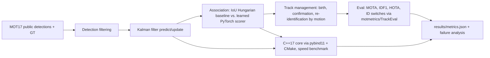

# Multi-Object Tracking - Kalman Filtering, Learned Association, and a C++ Tracking Core

`multi-object-tracking` · new project · estimated build effort: 6 h

## Problem

Tracking systems associate detections over time and estimate each object's state despite missed and noisy detections. This project builds tracking-by-detection on the MOT17 benchmark's public detections: a SORT-style baseline (constant-velocity Kalman filter + Hungarian assignment), then a learned association model in PyTorch (motion and box features) and track-management improvements, evaluated with MOTA, IDF1, and HOTA on held-out sequences, plus a C++17 implementation of the Kalman/association core exposed to Python and benchmarked for speed.

## Target jobs and skills

- **Torc Robotics — Senior, ML Engineer - Tracking** (`90700b03a0ae`): covers 81% of the JD's weighted top skills (Python, C++, PyTorch, Machine Learning, Optimization, Signal Processing, Model Evaluation, Computer Vision)
- **Amazon Web Services — Applied Scientist, Neuron Automated Reasoning Group** (`050237a19384`): covers 64% of the JD's weighted top skills (Python, C++, Optimization, Machine Learning)

Skills/tools this project demonstrates: Python, C++, PyTorch, Machine Learning, Deep Learning, Optimization, Signal Processing, Model Evaluation, Computer Vision, NumPy

## Data

- **Dataset:** MOT17 public detections and ground-truth labels (MOT17Labels; no images needed) — https://motchallenge.net/data/MOT17/
- **License/terms:** CC BY-NC-SA 3.0 (MOTChallenge terms; non-commercial portfolio use)
- **Size used:** ~10 MB label/detection archive; 7 training sequences with ground truth
- **Plan:** Ground truth is only public for the 7 training sequences, so they are split by sequence: 4 for training the association model, 1 for validation/tuning, 2 held out for the final evaluation. Test-sequence results are not claimed.

## Architecture

## Tech stack

Python 3.11, PyTorch (CPU), NumPy, SciPy, motmetrics, TrackEval, pybind11, scikit-build-core, CMake, MSVC, pytest

## Deliverables

- tracker/ package: Kalman filter, IoU and learned association, track management
- PyTorch association model trained on training sequences with a documented feature set
- C++17 Kalman + Hungarian core built from run.py (scikit-build-core/CMake with MSVC on Windows) with Python bindings and identical outputs to the Python version
- Evaluation on 2 held-out sequences with MOTA, IDF1, HOTA, ID switches; failure-mode analysis of the remaining errors

## Success criteria (all must hold on a from-scratch `python run.py`)

| Metric | Threshold | How it is measured |
|---|---|---|
| IDF1 on held-out sequences | >= SORT baseline + 3 points | motmetrics |
| ID switches | >= 15% fewer than the SORT baseline | motmetrics |
| MOTA on held-out sequences | >= SORT baseline (no regression) | motmetrics |
| C++ core correctness and speed | track outputs identical to Python on held-out sequences; >= 5x faster per frame | benchmark |
| Test coverage of src/ | >= 75% | pytest --cov |

## Evaluation artifacts (required; the evaluator recomputes metrics from these)

- results/split.json with keys train, val, heldout listing MOT17 training sequence names (heldout has 2 sequences)
- results/tracks/sort/<sequence>.txt and results/tracks/learned/<sequence>.txt in MOT format (frame,id,x,y,w,h,conf,-1,-1,-1) for every held-out sequence
- Ground truth left as downloaded under data/ (MOT17/train/<sequence>/gt/gt.txt)
- results/cpp_parity.json with keys identical (bool), py_ms_per_frame, cpp_ms_per_frame

## Baseline

SORT (constant-velocity Kalman filter + IoU Hungarian matching) on the same public detections.

## Constraints

- Runs on Windows with `python run.py` from a fresh virtualenv; no make, shell scripts, paid APIs, or accounts.
- CPU-only by default (an optional `--device cuda` flag is fine); peak RAM <= 3 GB; total downloads <= 1.5 GB.
- PyTorch (if used) pinned to the CPU wheel via `--extra-index-url https://download.pytorch.org/whl/cpu`.
- Fixed random seeds; every reported number is written by code to results/metrics.json (never typed by hand).
- Test split is created once, saved, and never used for training, tuning, or threshold selection.
- Data download is scripted (Python requests), cached under data/, and verified by checksum or row count.
- C++ is built with the installed MSVC Build Tools through scikit-build-core; no shell scripts.
- Report only held-out training-sequence results; never claim MOT17 test-server numbers.

## Draft resume bullets (placeholders are filled only with reproduced metrics)

- Built a tracking-by-detection system on MOT17 with a Kalman filter and a learned PyTorch association model, raising IDF1 to [IDF1] vs. [SORT_IDF1] for SORT on held-out sequences
- Cut identity switches by [IDSW_CUT] through learned association and track management, with failure-mode analysis of the remaining errors
- Wrote a C++17 Kalman/Hungarian tracking core with pybind11 bindings, matching Python outputs at [SPEEDUP] the speed
